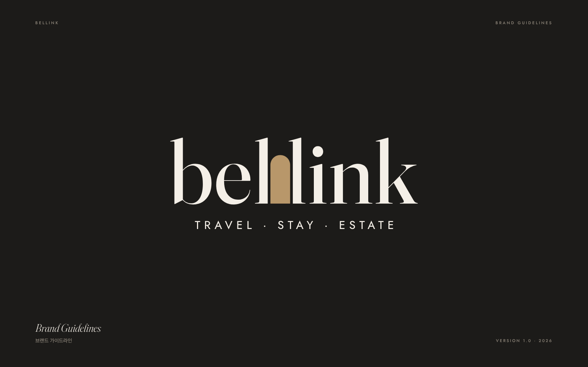
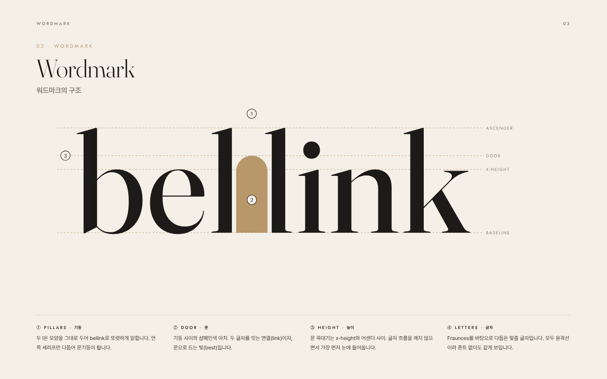
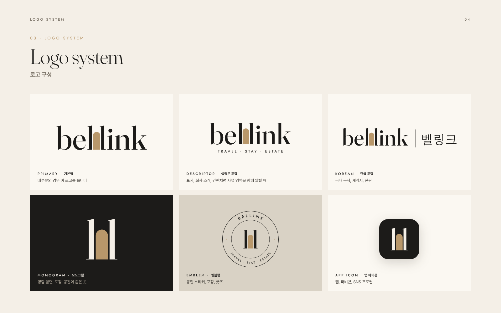

# bellink 브랜드 아이덴티티

**bellink = best(최고) + link(연결)**: 여행·숙박·부동산 투자를 잇는 최고의 연결

2차 시안의 **02 세리프 도어**를 다듬어 완성한 로고 시스템입니다.

**[브랜드 가이드 PDF (12쪽)](v3/bellink-brand-guide.pdf)**: 스토리, 워드마크 구조, 로고 구성, 여백과 최소 크기, 색상, 서체, 잘못된 사용 예, 적용 예시(명함·서식, 현판·객실 키·택, 웹·SNS)





## 콘셉트

bellink의 두 l은 문기둥이 되고, 그 사이에 샴페인색 **문**이 열립니다. 문은 여행이 시작되는 곳이고, 머무는 곳의 입구이며, 가치 있는 공간으로 들어가는 길입니다. 두 글자를 잇는 문은 연결(link)이고, 문으로 드는 빛은 그 너머의 최고(best)입니다.

2차 시안 대비 다듬은 점:

- 두 l을 아치로 이으면 n처럼 읽혀서, 두 l은 그대로 두고 그 사이에 문을 넣었습니다. 이제 bellink로 또렷하게 읽힙니다. 두 l의 안쪽 아래 세리프만 다듬어 문틀처럼 정리했습니다.
- 획을 약간 굵게(Fraunces 440) 하고 자간을 살짝 넓혀 작은 크기에서도 무너지지 않게 했습니다.
- 작은 크기 전용 **소형 워드마크**를 따로 만들었습니다. 가는 획이 사라지지 않도록 광학 크기를 낮춘 버전입니다.

## 파일

| 폴더 | 내용 |
|---|---|
| `v3/svg/` | 원본 벡터 (인쇄, 간판, 디자인 작업용) |
| `v3/png/` | 투명 배경 이미지 (문서, PPT, SNS용) |
| `v3/favicon/` | 웹사이트 아이콘 (`favicon.ico`, `favicon.svg`, 16–512px PNG, `apple-touch-icon.png`) |
| `v3/guide/` | 브랜드 가이드 페이지별 이미지 |

| 파일 이름 | 쓰임 |
|---|---|
| `bellink-wordmark` | **기본 로고.** 밝은 배경 |
| `bellink-wordmark-reverse` | 어두운 배경 (아이보리 + 샴페인 문) |
| `bellink-wordmark-ink`, `-white` | 단색 (도장, 음각, 박인쇄, 사진 위) |
| `bellink-wordmark-small`, `-small-reverse` | 폭 60–120px(15–30mm)의 작은 크기 전용 |
| `bellink-wordmark-descriptor`, `-reverse` | TRAVEL · STAY · ESTATE 설명문 조합 (표지, 간판) |
| `bellink-lockup-korean`, `-reverse` | 워드마크 + 벨링크 (국내 문서, 현판) |
| `bellink-korean`, `-reverse` | 한글 표기 벨링크 |
| `bellink-monogram`, `-reverse`, `-ink`, `-white` | 두 기둥과 문 모노그램 (명함 앞면, 작은 공간) |
| `bellink-emblem`, `-reverse` | 원형 엠블럼 (봉인 스티커, 포장, 굿즈) |
| `bellink-app-icon` | 앱 아이콘 (모서리 둥근 사각형) |
| `bellink-pattern-ivory`, `-ink` | 아치 패턴 (포장지, 배경, 웹 히어로) |

웹사이트에는 다음처럼 넣으면 됩니다.

```html
<link rel="icon" href="/favicon.ico" sizes="any">
<link rel="icon" href="/favicon.svg" type="image/svg+xml">
<link rel="apple-touch-icon" href="/apple-touch-icon.png">
```

## 색상

| 이름 | HEX | RGB | 쓰임 | 비율 |
|---|---|---|---|---|
| Ivory | `#F4EFE7` | 244 239 231 | 기본 바탕 | 55% |
| Ink | `#1C1B19` | 28 27 25 | 로고, 글자, 어두운 배경 | 30% |
| Stone | `#D9D2C5` | 217 210 197 | 보조 배경, 구분선 | 10% |
| Champagne | `#B8976A` | 184 151 106 | 문(best)과 포인트에만 | 5% |

샴페인색은 밝은 바탕 위 본문 글자로 쓰지 않습니다. 인쇄물에서는 금박이나 별색으로 표현하면 잘 어울립니다. 인쇄 전에는 인쇄소에서 색 교정을 받으세요.

## 서체

| 용도 | 서체 |
|---|---|
| 영문 제목 | Fraunces (Light 300, Regular 400, Italic) |
| 한글 제목 | Hahmlet 함렛 (Light 300) |
| 본문 | Pretendard 프리텐다드 (Regular, SemiBold) |
| 라벨·설명문 | Jost (대문자, 자간 0.3em) |

모두 SIL Open Font License로 상업적 사용이 무료입니다. 로고 워드마크는 맞춤 글자를 윤곽선으로 넣은 것이므로, 글꼴로 bellink를 입력해 로고를 대신하지 마세요.

## 사용 규칙 요약

- **여백**: 로고 둘레에 x(워드마크 n의 높이) 이상을 비웁니다.
- **최소 크기**: 기본형 폭 30mm / 120px, 소형 15mm / 60px, 모노그램 높이 6mm / 16px.
- **하지 말 것**: 비율 변형, 문 색 바꾸기, 문을 빼고 글꼴로 입력, 그림자·외곽선, 복잡한 배경, 회전.

가이드 속 카피(Open the door to the best. / 문을 열면, 최고의 연결)와 명함의 이름·주소는 예시입니다.

## 수정과 재생성

모든 파일은 `v3/source/generate.py` 하나로 만듭니다. 색, 문의 폭과 높이, 자간 같은 값을 바꾼 뒤 다시 실행하면 로고, 파비콘, 가이드 PDF가 함께 새로 만들어집니다.

```bash
pip install fonttools skia-pathops uharfbuzz
python3 brand/logo/v3/source/generate.py   # Node.js + Playwright, ImageMagick 필요
```

## 상표 등록 전 확인

출원 전에 [KIPRIS](https://www.kipris.or.kr)에서 비슷한 이름·도형 상표가 있는지 검색하세요. 관련 상품류는 39류(여행 알선), 43류(숙박), 36류(부동산)입니다.

## 이전 시안

- [2차 시안](v2/README.md): 아치, 세리프 도어, 모듈 b
- [1차 시안](v1/README.md): 피크 링크(네이비·골드) 외 2안
