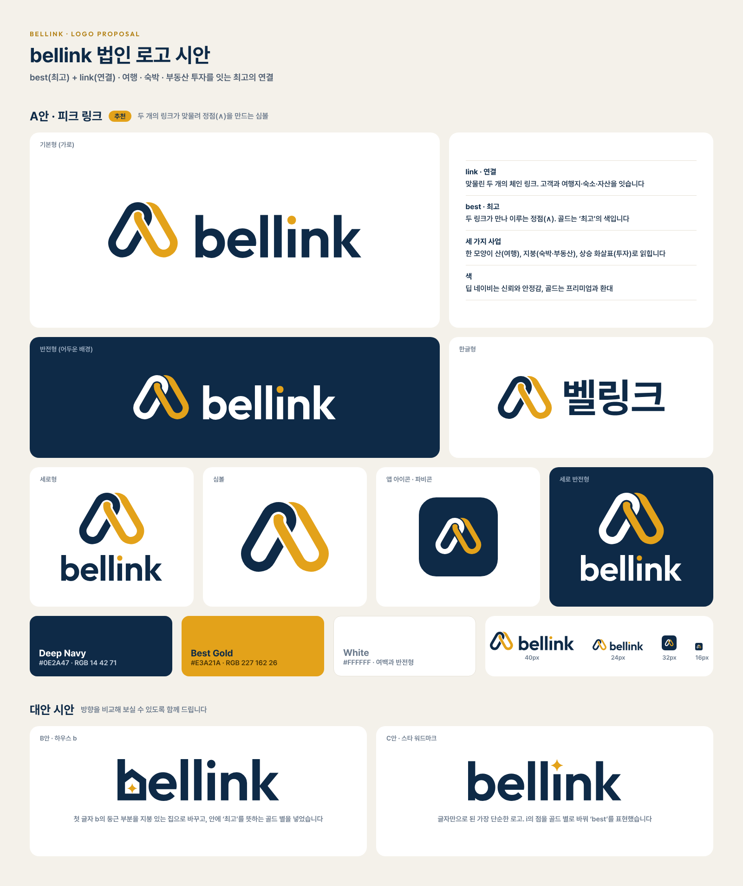

# bellink 로고: 1차 시안 (보관)

> 현재 시안은 [2차 시안](../README.md)을 보세요.

**bellink = best(최고) + link(연결)**: 여행·숙박·부동산 투자를 잇는 최고의 연결



## A안 · 피크 링크 (추천)

두 개의 체인 링크가 맞물려 정점(∧)을 이루는 심볼입니다.

| 요소 | 의미 |
|---|---|
| 맞물린 두 링크 | **link(연결)**: 고객과 여행지·숙소·자산을 잇는 회사 |
| 두 링크가 만나는 정점 | **best(최고)**: 가장 높은 곳, 최고의 서비스 |
| ∧ 모양 | 산(여행), 지붕(숙박·부동산), 상승 화살표(투자): 세 사업을 한 모양에 담음 |
| 네이비 + 골드 | 신뢰·안정감 + 프리미엄·환대 |

B안(하우스 b)과 C안(스타 워드마크)은 비교용 대안입니다. 대안을 고르시면 같은 구성(가로형·세로형·한글형·반전형·아이콘)으로 확장할 수 있습니다.

## 파일

모든 로고는 `svg/`(원본, 크기 무관)와 `png/`(투명 배경)에 있습니다. 인쇄물·간판에는 SVG를, 문서·SNS에는 PNG를 쓰세요.

| 용도 | 파일 |
|---|---|
| 기본 로고 (가로형) | `bellink-logo-horizontal` |
| 어두운 배경용 | `bellink-logo-horizontal-white`, `bellink-logo-vertical-white`, `bellink-logo-korean-white`, `bellink-symbol-white` |
| 세로형 (정사각형 공간, 표지) | `bellink-logo-vertical` |
| 한글형 | `bellink-logo-korean` |
| 단색 (도장, 팩스, 음각) | `bellink-logo-horizontal-navy`, `bellink-logo-horizontal-black`, `bellink-symbol-navy` |
| 심볼만 | `bellink-symbol` |
| 앱 아이콘·파비콘·SNS 프로필 | `bellink-app-icon` (PNG 1024 / 512 / 180 / 64 / 32px) |
| 대안 시안 | `concept-b-house-b-wordmark`, `concept-c-star-wordmark` |

## 색상

| 이름 | HEX | RGB | 쓰임 |
|---|---|---|---|
| Deep Navy | `#0E2A47` | 14, 42, 71 | 워드마크, 왼쪽 링크, 어두운 배경 |
| Best Gold | `#E3A21A` | 227, 162, 26 | 오른쪽 링크, i의 점 (강조색으로만) |
| White | `#FFFFFF` | 255, 255, 255 | 배경, 반전형 |

인쇄할 때는 인쇄소에서 CMYK 또는 별색(Pantone) 교정을 받으세요. 골드는 흰 배경 위 글자색으로 쓰면 잘 읽히지 않으니 그래픽 강조에만 씁니다.

## 사용 규칙

- **여백**: 로고 둘레에 심볼 높이의 절반 이상을 비워 두세요.
- **최소 크기**: 가로형은 화면에서 높이 24px, 인쇄에서 8mm 이상. 그보다 작으면 심볼이나 앱 아이콘을 씁니다.
- **배경**: 밝은 배경에는 기본형, 네이비·어두운 사진 위에는 `-white` 버전을 씁니다.
- **하지 말 것**: 비율 늘리기·찌그러뜨리기, 색 바꾸기, 그림자·외곽선 추가, 두 링크의 겹침 순서 바꾸기, 복잡한 사진 위에 바로 올리기.

## 서체

- 워드마크: **Outfit SemiBold**. 글자를 윤곽선으로 바꿔 넣었으므로 폰트가 없어도 똑같이 보입니다.
- 한글: **Pretendard Bold**.
- 두 서체 모두 SIL OFL 라이선스로 상업적 사용이 무료입니다. 명함·문서·웹사이트의 브랜드 서체로도 쓰세요.

## 수정과 재생성

로고는 `v1/source/generate.py`가 수치로 그립니다. 색, 링크 각도, 간격 등을 바꾼 뒤 다시 실행하면 모든 파일이 새로 만들어집니다.

```bash
pip install fonttools skia-pathops uharfbuzz
python3 brand/logo/v1/source/generate.py   # PNG 렌더링에는 Node.js + Playwright 필요
```

## 상표 등록 전 확인

출원 전에 [KIPRIS](https://www.kipris.or.kr)에서 비슷한 이름·도형 상표가 있는지 검색하세요. 관련 상품류는 39류(여행 알선), 43류(숙박), 36류(부동산)입니다.
