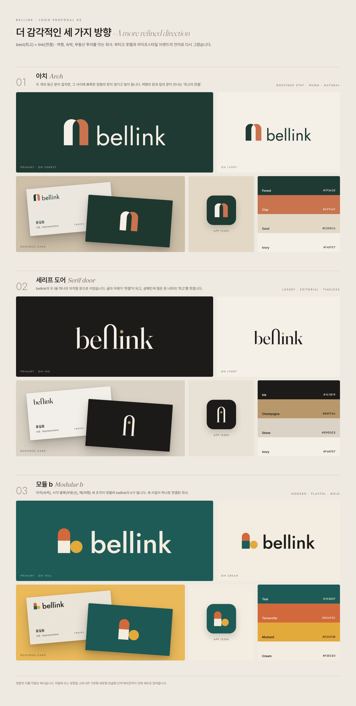

# bellink 로고: 2차 시안 (보관)

> 이 중 **02 세리프 도어**를 골라 다듬은 최종안은 [bellink 브랜드 아이덴티티](../README.md)에 있습니다.

부티크 호텔·라이프스타일 브랜드 톤으로 그린 세 가지 방향입니다.



## 01 아치 (Arch): 부티크 스테이 · 따뜻함 · 자연

두 개의 둥근 문(아치)이 겹치면 그 사이에 뾰족한 정점의 창이 생기고, 그 자리를 비워 빛이 드는 것처럼 보이게 했습니다. 여행의 문과 집의 문이 만나는 자리가 곧 &lsquo;최고의 연결&rsquo;입니다.

- 워드마크: Jost Regular
- 색: Forest `#1F3A32` · Clay `#C9734F` · Sand `#E3D8C6` · Ivory `#F4EFE7`

## 02 세리프 도어 (Serif door): 럭셔리 · 에디토리얼 · 타임리스

bellink의 두 l을 하나의 아치형 문으로 잇는 합자를 새로 그렸습니다. 글자 자체가 &lsquo;연결&rsquo;이 되고, i 위의 샴페인색 점은 문 너머의 &lsquo;최고&rsquo;를 뜻합니다. 짧은 표기(앱 아이콘, 명함 앞면)에는 문과 점만 씁니다.

- 워드마크: Fraunces (ll 합자는 직접 제작)
- 색: Ink `#1C1B19` · Champagne `#B8976A` · Stone `#D9D2C5` · Ivory `#F4EFE7`

## 03 모듈 b (Modular b): 모던 · 경쾌함 · 대담함

아치(숙박), 사각 블록(부동산), 해(여행) 세 조각이 맞물려 bellink의 b가 됩니다. 세 사업이 하나로 연결된 회사라는 뜻입니다.

- 워드마크: Jost Medium
- 색: Teal `#1E5B57` · Terracotta `#D2693C` · Mustard `#E2A93B` · Cream `#F3ECE0`

## 파일

각 방향 폴더(`01-arch`, `02-serif`, `03-modular`)에 SVG(원본)와 투명 배경 PNG가 있습니다.

| 파일 | 용도 |
|---|---|
| `bellink-<방향>-logo` | 가로형 로고 (밝은 배경) |
| `bellink-<방향>-logo-white` | 가로형 로고 (어두운 배경) |
| `bellink-<방향>-symbol` | 심볼·모노그램 (밝은 배경) |
| `bellink-<방향>-symbol-white` | 심볼·모노그램 (어두운 배경, 앱 아이콘) |

명함 속 이름과 직함은 예시입니다. 방향을 고르시면 세로형·한글형·단색·파비콘까지 전체 세트로 정리합니다.

## 서체와 재생성

Jost, Fraunces, Pretendard 모두 SIL OFL 라이선스로 상업적 사용이 무료입니다. 로고 속 글자는 윤곽선으로 바꿔 넣었으므로 폰트가 없어도 똑같이 보입니다.

```bash
pip install fonttools skia-pathops uharfbuzz
python3 brand/logo/v2/source/generate.py   # PNG·미리보기 렌더링에는 Node.js + Playwright 필요
```

상표 출원 전에는 [KIPRIS](https://www.kipris.or.kr)에서 비슷한 상표를 검색하세요. 관련 상품류는 39류(여행 알선), 43류(숙박), 36류(부동산)입니다.
