# BELLINK 로고 v4 (진행 중)

보내주신 **BELLINK 워드마크**와 **원 안의 B 스케치**를 바탕으로 만든 안입니다.

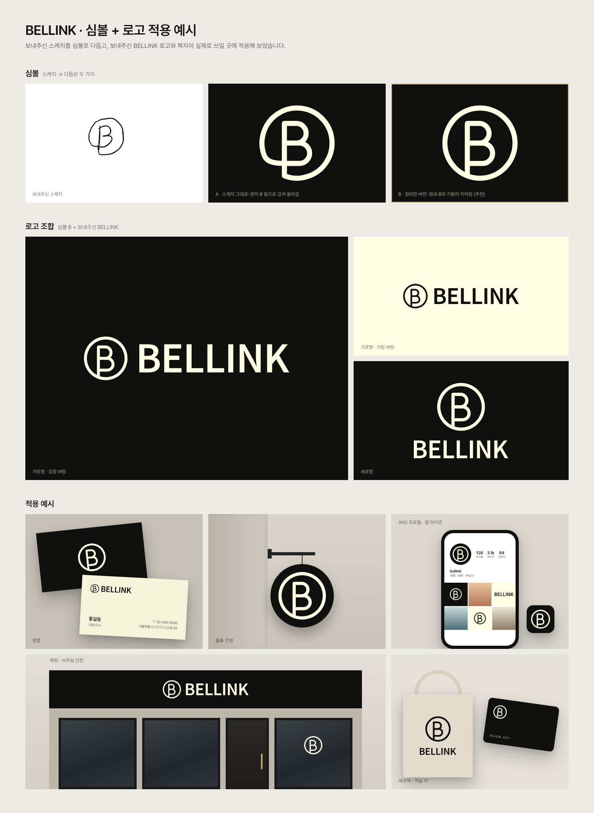

심볼을 일곱 가지로 더 풀어 본 비교: [bellink-v4-symbol-variations.png](bellink-v4-symbol-variations.png)

## 명함 흰색 세로 쌓기판 (아트보드 3·4 형식)

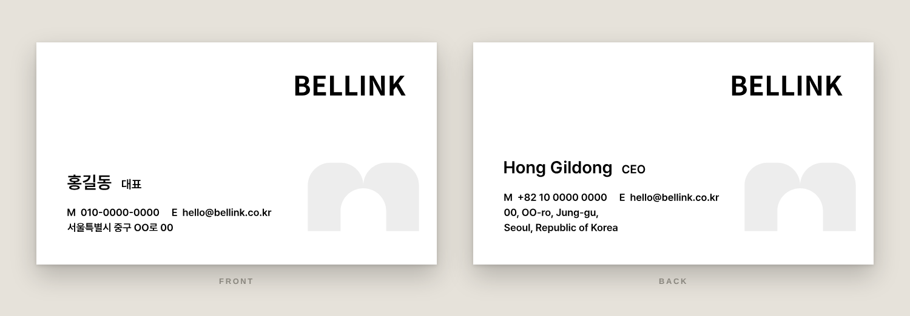

보내주신 아트보드 3·4 형식을 다듬은 안입니다.

- 오른쪽 위 BELLINK 워드마크, 왼쪽 아래 이름(11pt)과 직함(7.5pt), 그 아래 연락처·주소(6.5pt). 글씨는 Pretendard SemiBold.
- 원본보다 연락처·주소 글씨를 키우고(약 5.4pt → 6.5pt), 앞뒤 여백(왼쪽·오른쪽 7mm, 위·아래 7.5mm)과 이름·직함 기준선을 맞췄습니다.
- 오른쪽 아래 아치 심볼: BELLINK의 B를 눕혀 다리처럼 만든 모양으로, '연결'을 뜻합니다. 색을 채운 원본 그대로 잘리지 않게 넣었습니다. 폭 25mm(워드마크와 같은 폭), 오른쪽 여백 4mm, 바닥은 마지막 줄 기준선에 맞췄습니다. 진하기 7%(`#EDEDED` 단색). 스크립트에서 원형 B 심볼(`'b'`)로 바꿀 수 있습니다.

예시 정보(홍길동)로 만든 파일입니다. 실제 정보로 만들려면 `source/card-stack.example.json`을 복사해 `source/card-stack.json`(커밋되지 않음)으로 고친 뒤 실행합니다.

```bash
python3 brand/logo/v4/source/business_card_stack.py brand/logo/v4/source/card-stack.json 출력폴더
```

## 명함 흰색판 (보내주신 일러스트레이터 시안 기준)

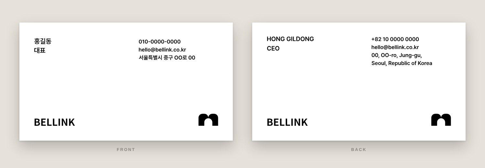

보내주신 일러스트레이터 명함 화면을 픽셀 단위로 재서 글씨체, 크기, 위치를 그대로 옮기고 정보만 바꿨습니다.

- 글씨: Pretendard SemiBold. 왼쪽 위 이름·직함은 앞면 8pt, 뒷면 7.5pt. 오른쪽 위 연락처·주소는 6.5pt.
- 앞면에는 한국어, 뒷면에는 영어 정보를 넣습니다. 두 덩어리의 첫 줄 기준선을 맞춥니다.
- 아래: 왼쪽 BELLINK 워드마크(명함용 굵기 680, 자간 0), 오른쪽 아치 심볼. 워드마크 기준선과 심볼 바닥을 맞춥니다. 심볼은 화면에서 모양을 재어 다시 그렸습니다(폭 39 : 높이 24, 위 모서리 반지름 8, 아치 폭 16, 아치 높이 15).
- 원본은 주소가 뒷면에만 있었는데, 이제 앞면에도 주소가 들어가서 앞면 연락처도 원본 뒷면 주소와 같은 자리·크기(6.5pt)로 맞췄습니다.

여기 있는 파일은 예시 정보(홍길동)로 만든 것입니다. 실제 정보로 만들려면 `source/card-white.example.json`을 복사해 `source/card-white.json`(커밋되지 않음)으로 고친 뒤 실행합니다.

```bash
python3 brand/logo/v4/source/business_card_white.py brand/logo/v4/source/card-white.json 출력폴더
```

## 심볼 파일 (명함 워터마크용)

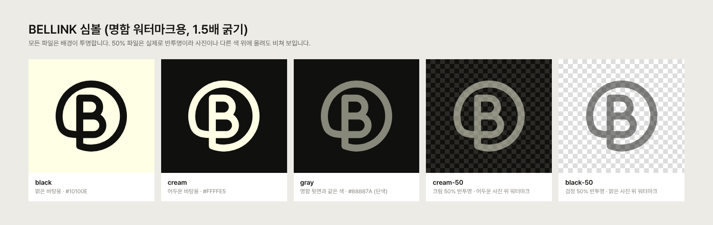

명함 뒷면에 쓴 심볼(심볼 A, 1.5배 굵기)을 따로 뽑은 파일입니다. `symbol/` 폴더에 색상별로 있습니다.

| 이름 끝 | 색 | 쓰임 |
|---|---|---|
| `-black` | `#10100E` | 밝은 바탕 |
| `-cream` | `#FFFFE5` | 어두운 바탕 |
| `-gray` | `#88887A` (단색) | 명함 뒷면과 같은 색. 검정 바탕 인쇄물 |
| `-cream-50` | 크림 50% 반투명 | 어두운 사진·영상 위 워터마크 |
| `-black-50` | 검정 50% 반투명 | 밝은 사진·영상 위 워터마크 |

- SVG: 원본 벡터. 크기를 얼마든지 키울 수 있습니다.
- PNG: 배경 투명, 2000 × 2000px.
- PDF: 인쇄·디자인 프로그램용 벡터, 100 × 100mm (black, cream).
- `symbol/share/`: 휴대폰·카카오톡 공유용 JPG(2000 × 2000px, 배경 있음). 투명 배경 PNG는 메신저에서 바탕이 검게 또는 하얗게 바뀌어 심볼이 안 보일 수 있어, 배경을 깐 이미지를 따로 만들었습니다. 흰 바탕+검정, 크림 바탕+검정, 검정 바탕+크림, 검정 바탕+회색 네 가지입니다.

다시 만들기: `python3 brand/logo/v4/source/export_symbol.py`

## 명함 (앞뒤)

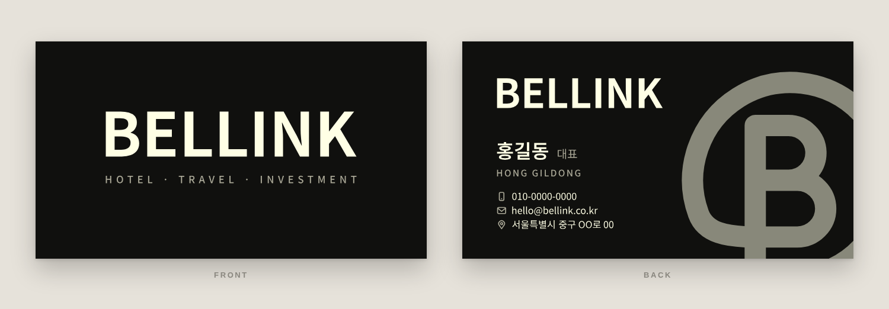

- 앞면: BELLINK 워드마크(폭 56mm) 아래에 HOTEL · TRAVEL · INVESTMENT. 작은 글씨 줄의 폭을 워드마크 폭에 맞췄습니다.
- 뒷면: 워드마크, 이름, 아이콘을 붙인 연락처(전화, 이메일, 주소. 정보 파일에 `instagram` 줄을 넣으면 인스타그램도 들어감), 오른쪽에 ‘조금 잘림’ 워터마크 심볼(1.5배 굵기, 투명도 50%를 단색 `#88887A`로 환산).
- 명함의 워드마크는 로고 원본(굵기 600, 자간 -0.02em)보다 조금 굵고(680) 자간이 조금 넓습니다(0em).
- 인쇄용 PDF는 재단 여유 1mm씩을 더한 92 × 52 mm(재단 후 90 × 50 mm) 두 쪽이고, 글자는 모두 윤곽선이라 폰트가 필요 없습니다.

여기 있는 파일은 예시 정보(홍길동)로 만든 것입니다. 저장소가 공개라 실제 연락처가 담긴 명함은 올리지 않습니다. 실제 정보로 만들려면 `source/card-info.example.json`을 복사해 `source/card-info.json`(커밋되지 않음)으로 고친 뒤 실행합니다.

```bash
python3 brand/logo/v4/source/business_card.py brand/logo/v4/source/card-info.json 출력폴더
```

## 워터마크 잘림 정도 조정

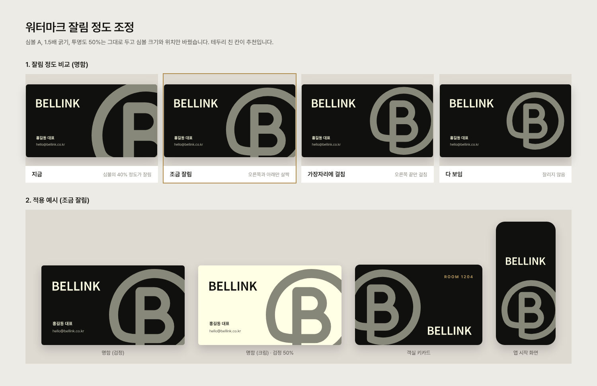

적용 예시의 심볼이 너무 잘려 보여, 굵기(1.5배)와 투명도(50%)는 그대로 두고 크기와 위치만 바꿨습니다. 지금, 조금 잘림(추천), 가장자리에 걸침, 다 보임 네 단계를 명함으로 비교하고, 조금 잘림을 명함·객실 키카드·앱 시작 화면에 적용했습니다.

## 심볼 A 워터마크 시안

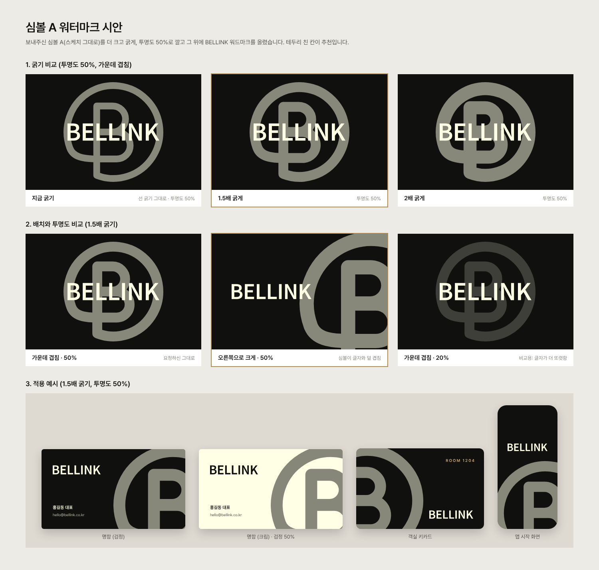

심볼 A를 더 크고 굵게(선 굵기 1.5배, 2배), 투명도 50%로 깔고 그 위에 워드마크를 올렸습니다. 가운데 겹침, 오른쪽으로 크게 잘라 배치, 투명도 20% 비교와 명함·객실 키카드·앱 시작 화면 예시가 있습니다.

## 잘나가는 브랜드 로고 벤치마크 분석

여행, 숙박, 부동산 투자 업종의 대표 브랜드와 ‘연결’을 로고로 표현한 브랜드를 살펴보고, 벨링크에 맞는 방식을 골랐습니다. 전체 보고서: [benchmark/bellink-logo-benchmark.pdf](benchmark/bellink-logo-benchmark.pdf)

| 쪽 | 내용 |
|---|---|
| [1](benchmark/bellink-benchmark-01.png) | 업종별 공통점과 벨링크에 주는 시사점 |
| [2](benchmark/bellink-benchmark-02.png) | 살펴본 브랜드 10곳(묶음 포함)과 적합도 |
| [3](benchmark/bellink-benchmark-03.png) | 다섯 가지 로고 방식을 벨링크에 대입한 시안 |
| [4](benchmark/bellink-benchmark-04.png) | 추천안, 2·3순위, 피할 것, 다음 단계 |

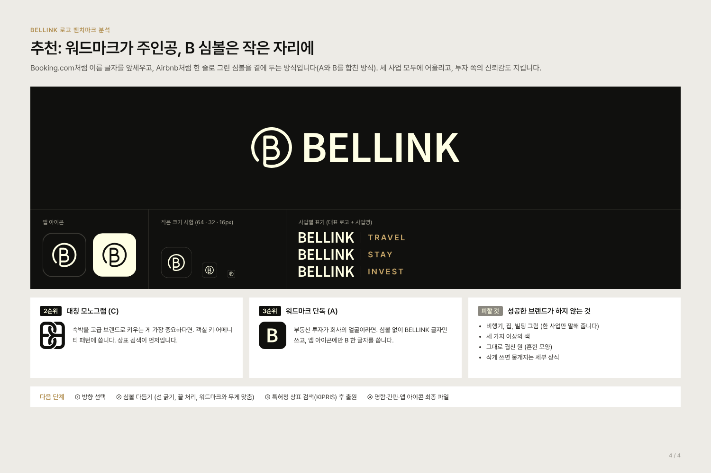

**추천**: BELLINK 워드마크를 주인공으로 두고, 한 줄로 그린 B 심볼은 앱 아이콘·파비콘·간판처럼 작은 자리에 씁니다(Booking.com + Airbnb 방식). 2순위는 대칭 모노그램(두 B를 맞물린 안), 3순위는 워드마크 단독입니다.

로고 이미지는 상표권 때문에 싣지 않고 글로 설명했습니다. 참고한 자료:

- Airbnb Bélo: [Design Week](https://www.designweek.co.uk/issues/july-2014/designstudio-creates-symbol-of-belonging-for-airbnb-rebrand/), [designboom](https://www.designboom.com/design/airbnb-rebrand-gives-its-community-a-sense-of-belonging-07-16-2014/)
- Tripadvisor 2020: [It’s Nice That](https://www.itsnicethat.com/news/tripadvisor-rebrand-mother-design-graphic-design-050220), [Design Week](https://www.designweek.co.uk/issues/27-january-2-february-2020/tripadvisor-reveals-new-logo-ahead-of-year-long-identity-refresh)
- Mastercard 2019: [Dezeen](https://www.dezeen.com/2019/01/10/mastercard-rebrand-pentagram-design/), [Design Week](https://www.designweek.co.uk/mastercard-new-logo-first-time-20-years-2/)
- Audi 네 고리: [Audi 보도자료](https://www.audi.com/en/press-releases/how-the-four-rings-became-the-audi-trademark-auto-union-ag-founded-90-years-ago-14750)
- Aman 워드마크: [BP&O](https://bpando.org/2016/02/16/branding-aman/)
- Four Seasons 나무 로고: [Cooper Hewitt](https://collection.cooperhewitt.org/objects/974522569), [Creative Bloq](https://www.creativebloq.com/news/four-seasons-logo-design)
- Chanel CC: [Fabrik Brands](https://fabrikbrands.com/branding-matters/logofile/chanel-symbol-and-logo-history-evolution-of-the-chanel-logo/)
- Booking.com: [1000logos](https://1000logos.net/booking-com-logo/)

## 지금까지의 심볼 후보 모음 (방향 정하는 중)

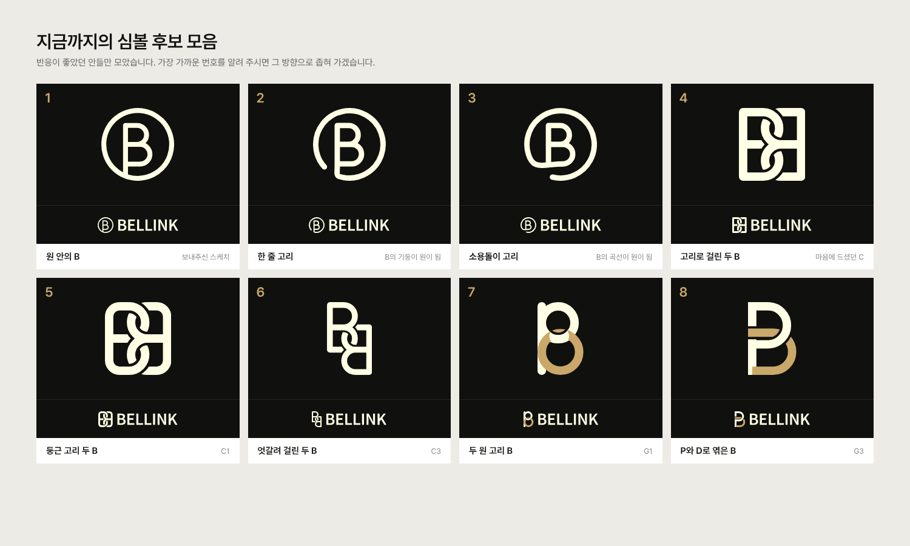

반응이 좋았던 안 여덟 가지를 한 장에 모았습니다. 여기서 방향을 하나로 좁힌 뒤 최종 세트를 만듭니다.

## BELLINK 글자로 만드는 심볼 아이디어 (보류)

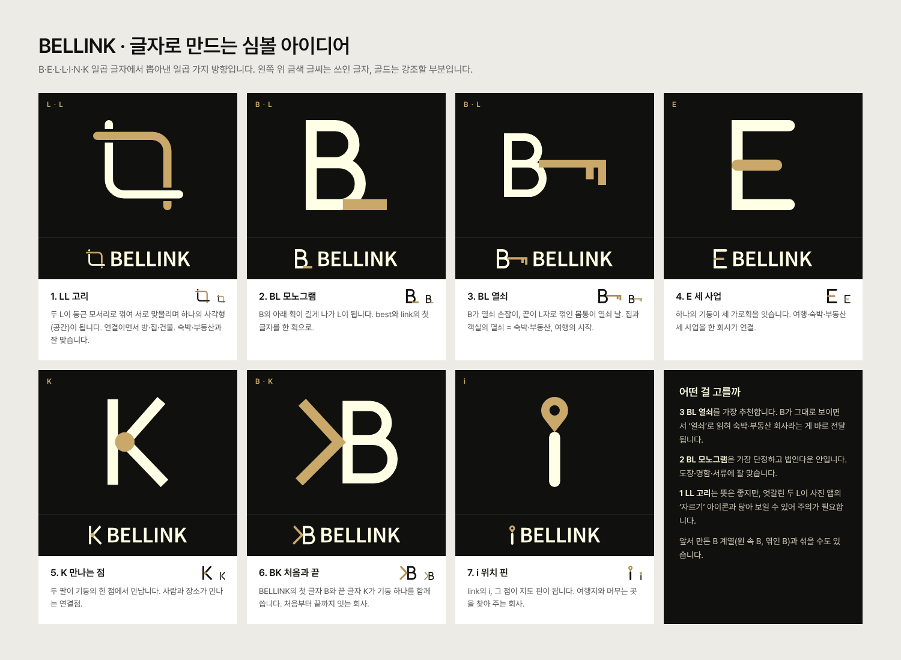

LL 고리, BL 모노그램, BL 열쇠, E 세 사업, K 만나는 점, BK 처음과 끝, i 위치 핀. 모두 마음에 들지 않으셔서 보류했습니다.

## 고리 부분 다시 보기 (선택 중)

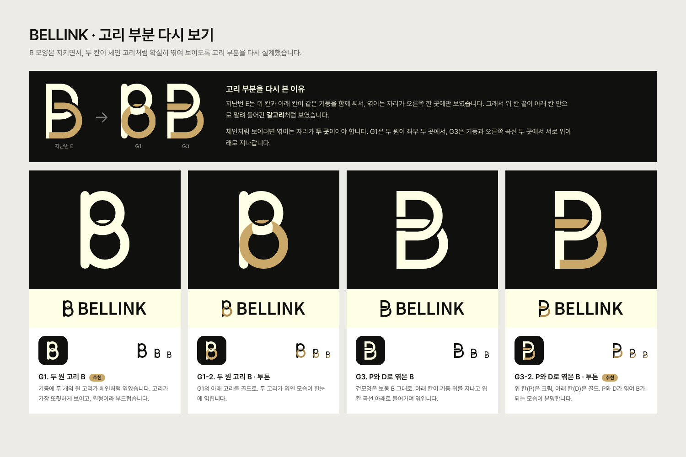

체인처럼 보이려면 엮이는 자리가 두 곳이어야 합니다. G1은 기둥에 두 원 고리가 좌우 두 곳에서 엮이고, G3은 보통 B 모양을 지키면서 아래 칸이 기둥 위를 지나고 오른쪽에서 위 칸 곡선 아래로 들어갑니다.

## 더 B답게 엮은 고리 (선택 중)

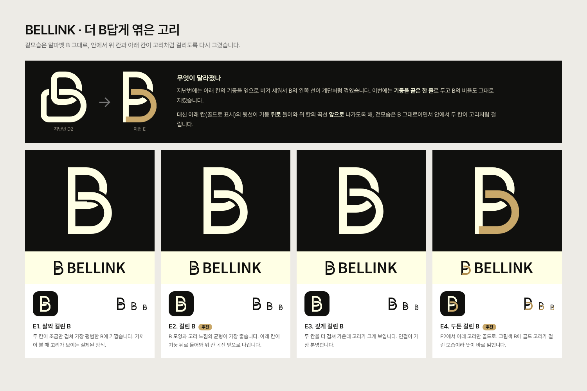

기둥은 곧은 한 줄, B의 비율도 그대로 두고, 아래 칸의 윗선이 기둥 뒤로 들어와 위 칸의 곡선 앞으로 나가도록 해 안에서 두 칸이 고리처럼 걸리게 했습니다.

## B 한 글자로 엮은 고리 (선택 중)

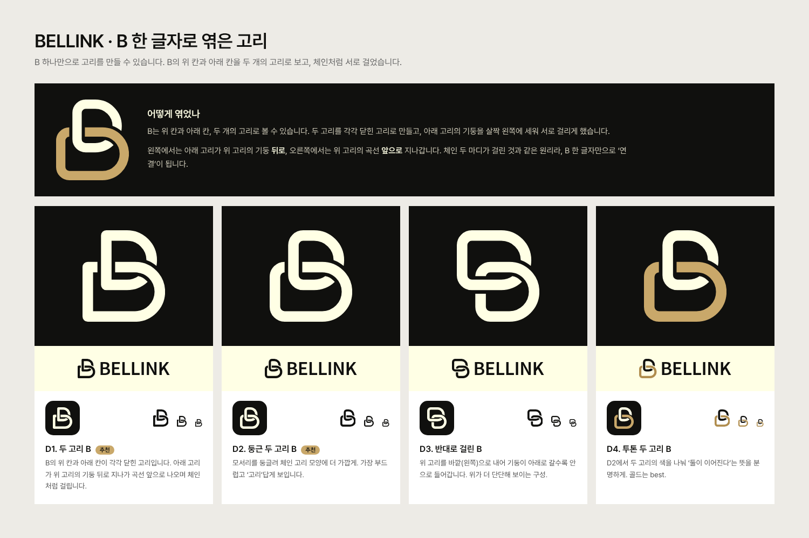

B의 위 칸과 아래 칸을 각각 닫힌 고리로 만들고, 아래 고리의 기둥을 살짝 왼쪽에 세워 체인처럼 서로 걸었습니다. 왼쪽에서는 아래 고리가 위 고리의 기둥 뒤로, 오른쪽에서는 위 고리의 곡선 앞으로 지나갑니다.

## 서로 이어진 두 B (선택 중)

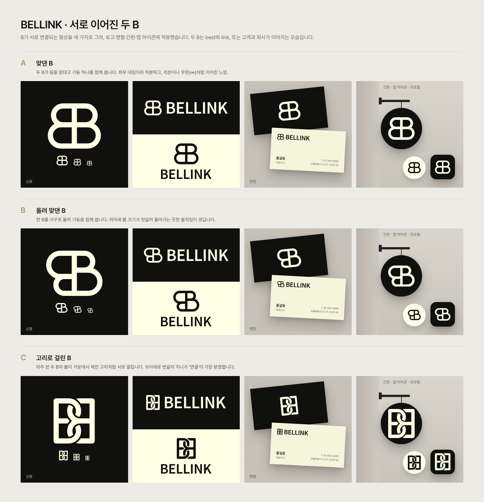

- **A 맞댄 B**: 두 B가 등을 맞대고 기둥 하나를 함께 씀 (좌우 대칭)
- **B 돌려 맞댄 B**: 한 B를 거꾸로 돌려 기둥을 함께 씀 (점대칭)
- **C 고리로 걸린 B**: 마주 본 두 B의 볼이 가운데서 체인 고리처럼 걸림

C를 바탕으로 더 풀어 본 안 (둥근 고리, 깊게 걸린, 엇갈려 걸린, 가는 선, 투톤, 원 안의 고리):

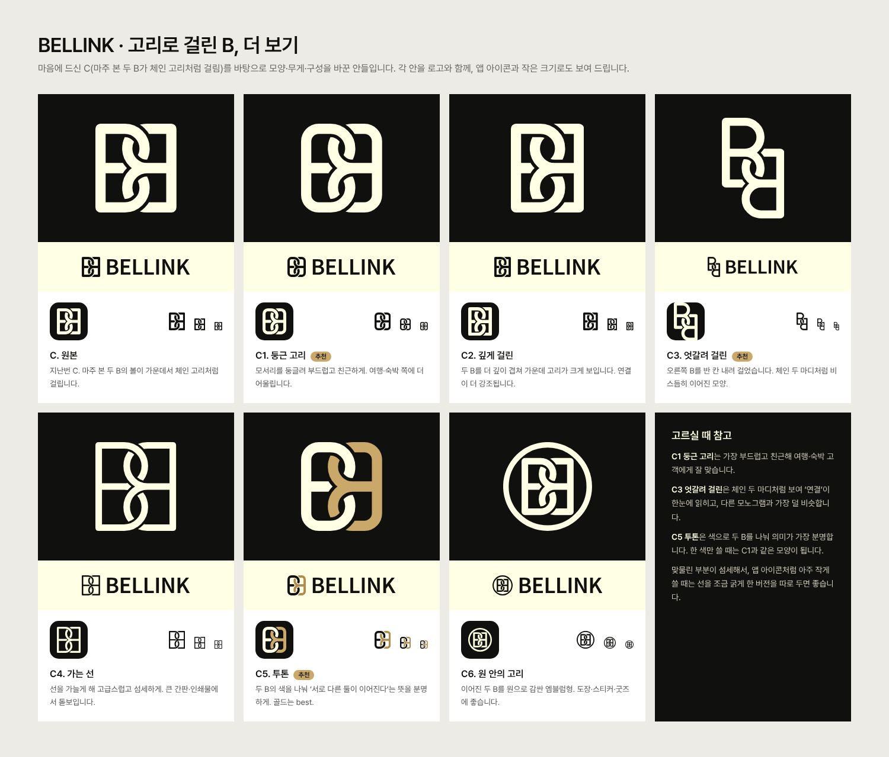

## 고리 심볼 (선택 중)

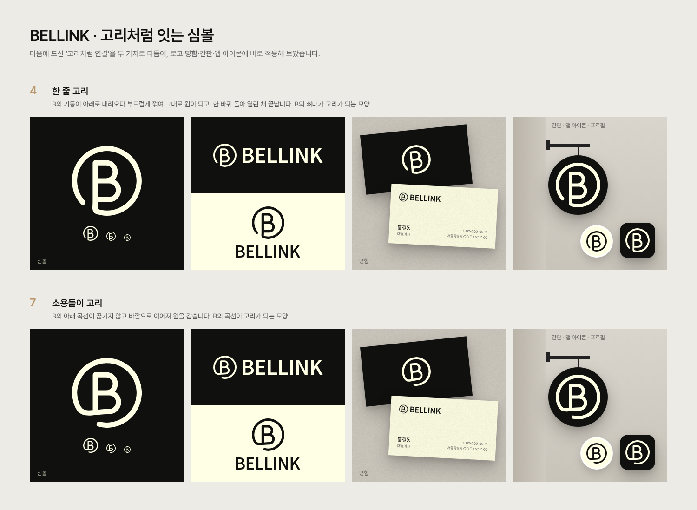

- **한 줄 고리** (`-loop`): B의 기둥이 내려오다 부드럽게 꺾여 그대로 원이 되고, 한 바퀴 돌아 열린 채 끝납니다.
- **소용돌이 고리** (`-spiral`): B의 아래 곡선이 끊기지 않고 바깥으로 이어져 원을 감습니다.

## 구성

- **워드마크**: 보내주신 이미지를 벡터로 재현했습니다. Noto Sans KR SemiBold(600), 자간 -0.02em로 글자 폭과 전체 길이가 원본과 일치합니다.
- **심볼 B (추천)**: 원 안의 한 줄 굵기 B. B의 기둥이 아래로 내려와 원과 이어집니다. B(best)와 원(link, 연결)이 한 선으로 묶인 모양입니다.
- **심볼 A**: 스케치 그대로. 원이 왼쪽 아래에서 B의 밑으로 감겨 들어갑니다.
- **색**: 검정 `#10100E`, 크림 `#FFFFE5` (보내주신 이미지에서 추출)

## 파일

`svg/`(원본)와 `png/`(투명 배경)에 같은 이름으로 있습니다. `-cream`이 붙은 파일은 어두운 바탕용입니다.

| 파일 | 쓰임 |
|---|---|
| `bellink-logo-horizontal` | 심볼 + 워드마크 가로형 |
| `bellink-logo-vertical` | 심볼 위, 워드마크 아래 세로형 |
| `bellink-wordmark` | 워드마크만 |
| `bellink-symbol` | 심볼 B (추천) |
| `bellink-symbol-alt` | 심볼 A (스케치 그대로) |
| `bellink-app-icon` | 앱 아이콘 (검정 바탕 + 크림 심볼) |
| `bellink-symbol-loop`, `bellink-logo-horizontal-loop`, `bellink-logo-vertical-loop` | 한 줄 고리 심볼과 로고 조합 |
| `bellink-symbol-spiral`, `bellink-logo-horizontal-spiral`, `bellink-logo-vertical-spiral` | 소용돌이 고리 심볼과 로고 조합 |

명함 속 이름·주소와 SNS 화면은 예시입니다.

## 다시 만들기

```bash
pip install fonttools skia-pathops uharfbuzz
python3 brand/logo/v4/source/generate.py   # PNG 렌더링에는 Node.js + Playwright 필요
```

심볼의 선 굵기(`STROKE`), B의 위치와 비율(`A`, `YT`, `YM`, `YB`, `WU`, `WL`)을 바꿔 다시 실행하면 모든 파일이 함께 바뀝니다.
